<p align="center">
  
</p>

<p align="center">
  <a href="https://github.com/Gustavo16378/tyranitar-capim-dourado/actions/workflows/ci.yml"></a>
  
  
  <a href="https://tyranitar-capim-dourado.pages.dev"></a>
  <a href="LICENSE"></a>
</p>

Solução da equipe Tyranitar para o tema 04 do HackaRun 2026: a jornada de compra integrada, digital e física, do Capim Dourado Shopping.

## Primeira entrega

- [Documento da primeira entrega (PDF)](docs/Capi_Tyranitar_Primeira_Entrega.pdf)
- [Onde está cada item pedido](docs/primeira-entrega.md)
- [Design system publicado](https://tyranitar-capim-dourado.pages.dev/design-system)
- [App no ar](https://tyranitar-capim-dourado.pages.dev)

## A solução

O cliente pergunta à **Capi**, a assistente de IA do shopping, por texto, foto ou link. Ela acha o produto nas lojas, o cliente reserva e segue a rota no mapa. No balcão, o vendedor lê o QR da carteira e já sabe o que o cliente procura. A compra vira pontos de fidelidade e dados para lojistas e para o shopping.

Um site só, com três interfaces:

| Rota | Para quem |
| --- | --- |
| `/` | Cliente, no celular (PWA) |
| `/loja` | Lojista |
| `/shopping` | Administração do shopping |
| `/design-system` | Design system: tokens, componentes e movimentos nos temas claro e escuro |

A Capi é a assistente de IA do app; o nome do app será definido junto com o shopping.

### A jornada do cliente

<p align="center">
  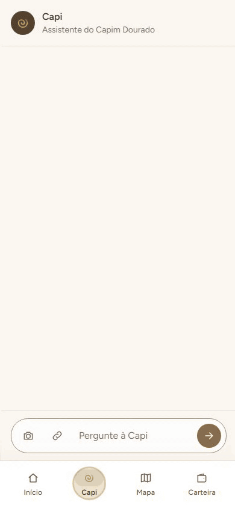
</p>

A Capi acha o tênis pela foto, a cliente reserva com Pix, segue a rota até a loja no mapa 3D e abre a carteira. Gravado com o Playwright num celular de 390 px (`node scripts/gravar-jornada.mjs`).

### Telas

| Abertura | Início | Capi | Produto | Como reservar |
| :---: | :---: | :---: | :---: | :---: |
| 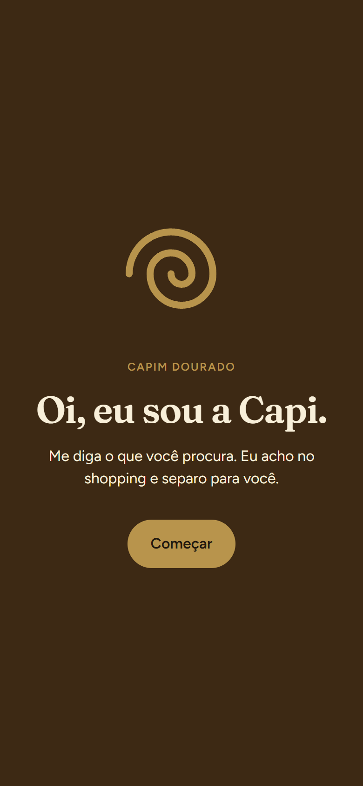 | 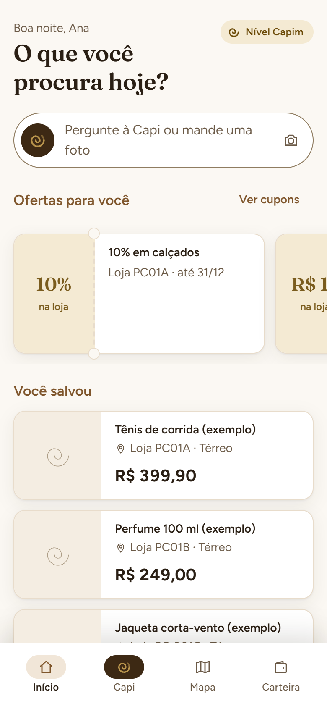 | 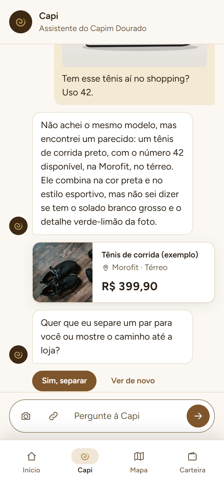 | 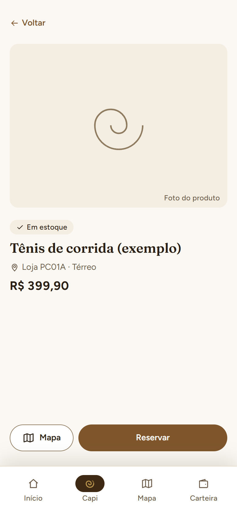 | 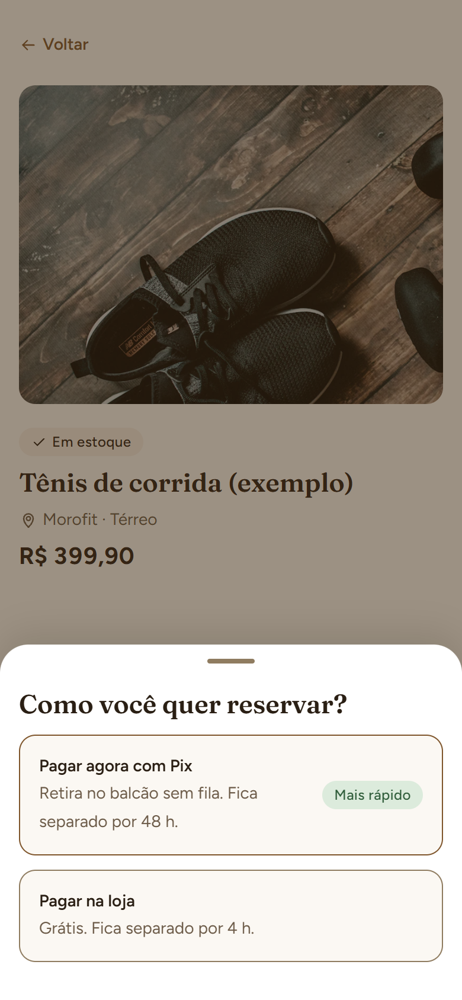 |

| Reserva | Mapa | Carteira | Reservas e cupons | Painel da loja |
| :---: | :---: | :---: | :---: | :---: |
| 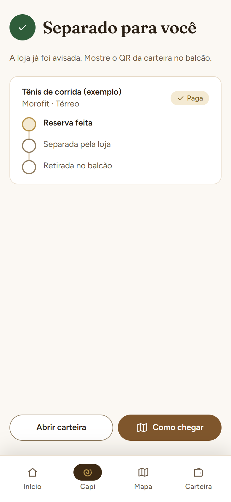 | 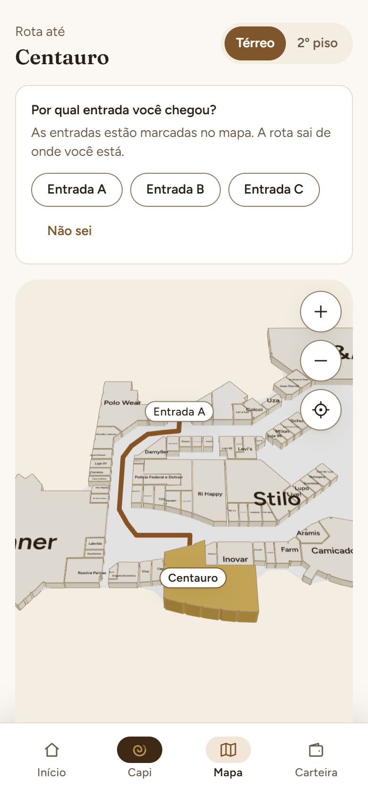 | 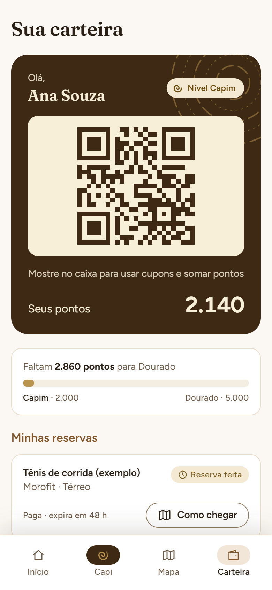 | 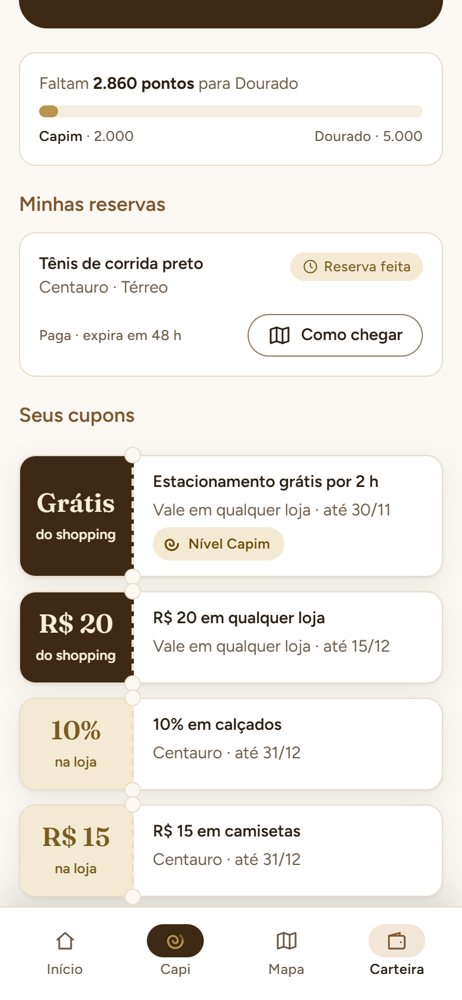 | 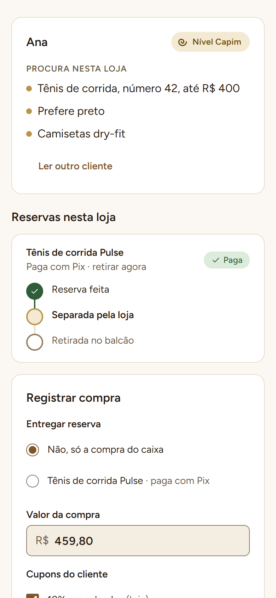 |

## Arquitetura

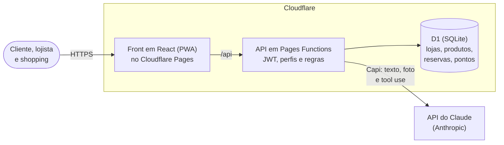

React 19, Vite, TypeScript e Tailwind no front. Cloudflare Pages Functions e D1 (SQLite) no back, no mesmo deploy. A Capi usa a API do Claude, chamada só pelo servidor: a chave nunca vai para o navegador. Os detalhes, as tecnologias e as pastas estão em [docs/arquitetura.md](docs/arquitetura.md).

## Como rodar

Requisito: Node 22.12 ou mais novo.

```bash
npm install
cp .dev.vars.exemplo .dev.vars   # preencha as chaves e as senhas; o .dev.vars fica fora do Git
npm run db:migrar                # cria as tabelas no banco D1 local
npm run seed:local               # lojas da planta, produtos, cupons e usuários de teste
npm run dev                      # front em http://localhost:5173
npm run dev:api                  # build + Functions e D1 local em http://localhost:8788
```

Com os dois rodando, o front do `npm run dev` chama a API pelo proxy de `/api`. Para conferir as Functions: `http://localhost:8788/api/saude` responde `{ "ok": true }`. Os usuários de teste (cliente, lojista e administração) estão descritos no `.dev.vars.exemplo`; as senhas ficam só no `.dev.vars` de cada um.

O seed não é migration: as migrations só criam o esquema. `npm run seed:local` e `npm run seed:remoto` podem rodar quantas vezes for preciso (atualizam em vez de duplicar), então quando os CSVs das lojas e dos produtos mudarem basta rodar de novo. A categoria de cada loja sai do nome da marca (`scripts/categorias-das-marcas.mjs`, ou a coluna `categoria` do `lojas.csv`, se existir) e vem antes das categorias dos produtos dela: é a que dá a capa no painel do shopping. Uma marca nova sem categoria aparece num aviso no fim do seed.

Outros comandos: `npm run build`, `npm run lint`, `npm run typecheck` e `npm test` (unidade e API). Os testes no navegador (`npm run test:e2e` e `npm run test:a11y`) sobem sozinhos o site com o modo demonstração e um banco de teste; na primeira vez, instale o Chromium com `npx playwright install chromium`. O CI roda tudo isso a cada push.

## Modo demonstração

Para o pitch e para a banca testar sem cadastro. São três chaves, ligadas com `1`; nenhuma é segredo.

| Chave | Quem lê | No hackathon | O que faz |
| --- | --- | --- | --- |
| `VITE_MODO_DEMO` | Front, no build | `1`, no `.env.local` | A Capi abre tocando o roteiro da demonstração (o print do tênis). Desligada, abre vazia. |
| `DEMO` | Functions | `1`, no `[vars]` do `wrangler.toml` | Liga `POST /api/auth/demo`, o botão "Entrar com a conta de demonstração" (entra como a cliente Ana, sem senha). Desligada, a rota responde 404. |
| `CAPI_MODO_DEMO` | Functions | `0`, no `[vars]` do `wrangler.toml` | Com `0`, a Capi é o Claude de verdade, também no roteiro, e as respostas salvas (`functions/_lib/capi/demonstracao.json`) só entram se ele falhar. Com `1`, o roteiro sai sempre das respostas salvas, sem chamar o Claude (para apresentar sem internet). |

Na máquina:

```bash
echo VITE_MODO_DEMO=1 > .env.local   # o Vite não lê o .dev.vars; o .env.local fica fora do Git
# DEMO e CAPI_MODO_DEMO vêm do wrangler.toml; o .dev.vars muda as duas só na sua máquina
npm run dev:api                      # http://localhost:8788
```

Em produção, `DEMO` e `CAPI_MODO_DEMO` vão no deploy pelo `[vars]` do `wrangler.toml`. O `VITE_MODO_DEMO` entra no build: o deploy sobe o `dist/` pronto, então o `npm run build` precisa rodar com o `.env.local` acima. Para desligar depois do hackathon, troque `DEMO` para `"0"` e apague o `.env.local`.

Entre um ensaio e outro, e antes do pitch:

```bash
npm run demo:reset   # no D1 de produção; não precisa de deploy
```

Ele cancela as reservas em aberto da Ana, apaga a conversa dela com a Capi (para a Capi não lembrar dos ensaios) e devolve o estoque do seed, rodando o seed de novo. Por isso precisa das senhas `SEED_SENHA_*` no `.dev.vars`, como o `npm run seed:remoto`. Os produtos da demo têm 20 unidades cada no `produtos.csv` do kit, para os ensaios não esgotarem. Para testar na máquina: `node scripts/demo-reset.mjs --local`.

## Documentação

Fica em [`docs/`](docs/):

- [Arquitetura](docs/arquitetura.md)
- [Requisitos](docs/requisitos.md)
- [Telas](docs/telas.md)
- [Design system](docs/design-system.md)
- [Banco de dados](docs/banco.md)
- [API](docs/api.md)
- [UML](docs/uml.md)
- [Plano de testes](docs/testes.md)
- [Créditos das imagens](docs/creditos.md)
- [Primeira entrega](docs/primeira-entrega.md)

## Equipe

| Integrante | Papel |
| --- | --- |
| Gustavo Barbosa Lima | Desenvolvimento back-end, Capi (IA) e integração |
| Gustavo Ferreira | Design, front-end e mapa do shopping |
| Kauã | Documentação e modelo de negócio |
| Diogo | Pitch, roteiro e vídeo |

**Orientadores:** Haroldo Soares e Paulo Rafael.

## Uso de inteligência artificial

Declaração do item 6.3 do edital.

- **Ferramentas:** Claude e Claude Code, da Anthropic.
- **Para quê:** ideação, requisitos, protótipo, programação, testes, documentação e o desenho do mapa das lojas.
- **Revisão:** a equipe revisou e testou tudo o que foi feito com IA.
- **No produto:** a Capi, a assistente do app, usa a API do Claude. A chamada sai só do servidor, que entende a pergunta por texto, foto ou link e busca nos produtos das lojas do shopping.
- **Dados:** os usuários e as buscas do seed são fictícios.

## Licença

O código é distribuído sob a [licença MIT](LICENSE), © 2026 Equipe Tyranitar. As fotos dos produtos e das capas são do Unsplash, com a licença própria descrita em [docs/creditos.md](docs/creditos.md).
