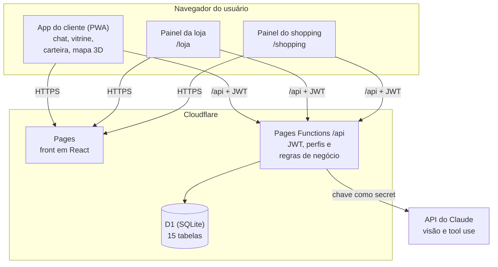
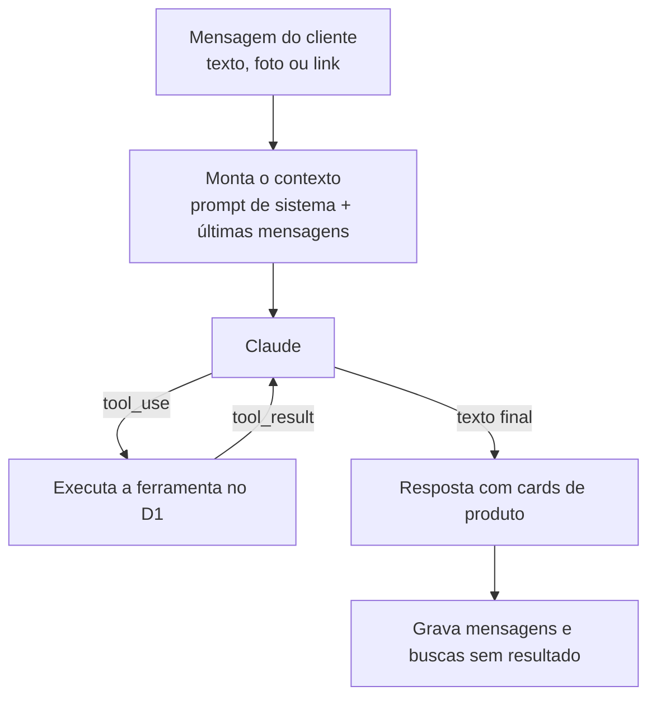

# Arquitetura

O sistema inteiro roda no Cloudflare, num repositório e num deploy só: o front (app do cliente e painéis) é servido pelo Cloudflare Pages, a API roda em Pages Functions no mesmo domínio e os dados ficam no banco D1. A Capi é a única parte que sai do Cloudflare, chamando a API do Claude a partir do servidor.

## Visão geral



## Tecnologias

| Camada | Tecnologia | Motivo |
| --- | --- | --- |
| Front | React + Vite + TypeScript + Tailwind | Rápido de desenvolver, tipado, um projeto só para app e painéis |
| PWA | `vite-plugin-pwa` | App instalável, sem loja de apps; a banca abre pelo link |
| Mapa 3D | `@react-three/fiber` + `@react-three/drei` (Three.js) | 3D declarativo em React, com controles de câmera prontos |
| QR | `qrcode.react` (gerar) e `html5-qrcode` (ler pela câmera) | Funcionam no navegador, sem app nativo |
| Gráficos | `recharts` | Gráficos dos painéis com pouco código |
| API | Cloudflare Pages Functions (TypeScript) | Mesmo deploy do front, sem servidor para manter, sem cold start |
| Banco | Cloudflare D1 (SQLite) | Gratuito na escala da demo, migrations versionadas pelo `wrangler` |
| Autenticação | JWT (HS256) com `jose`, senhas com PBKDF2 (Web Crypto) | Roda no runtime do Cloudflare, sem dependência nativa |
| IA | API do Claude (Anthropic), com visão e tool use | Entende foto e texto e chama funções do sistema |
| Testes | Vitest, `@cloudflare/vitest-pool-workers`, Playwright, axe-core | Pirâmide completa, rodando no CI |
| CI | GitHub Actions | Testes a cada push e pull request |

## Estrutura de pastas

```text
tyranitar/
├── src/                      # Front (React)
│   ├── app/                  # Telas do cliente: chat, vitrine, produto, carteira, mapa
│   ├── loja/                 # Painel da loja (/loja)
│   ├── shopping/             # Painel do shopping (/shopping)
│   ├── componentes/          # Componentes compartilhados
│   ├── mapa/                 # Cena 3D, planta em SVG e grafo de rotas
│   ├── api/                  # Cliente HTTP tipado e mocks do contrato
│   └── tipos/                # Tipos compartilhados com a API
├── functions/                # Back (Pages Functions)
│   ├── api/                  # Uma pasta por recurso, espelhando as rotas
│   │   ├── _middleware.ts    # Valida o JWT e injeta o usuário
│   │   ├── auth/
│   │   ├── chat.ts           # Capi: loop de tool use com o Claude
│   │   ├── produtos/
│   │   ├── reservas/
│   │   ├── me/
│   │   ├── loja/
│   │   └── shopping/
│   └── _lib/                 # Regras de negócio puras, acesso ao banco, erros
├── migrations/               # SQL do D1, aplicado em ordem pelo wrangler
├── tests/
│   ├── unidade/              # Regras puras (Vitest)
│   ├── api/                  # Rotas com D1 local (vitest-pool-workers)
│   ├── e2e/                  # Jornadas no navegador (Playwright)
│   └── a11y/                 # Acessibilidade (axe-core)
├── docs/                     # Esta documentação
└── wrangler.toml             # Binding do D1 e configuração do Pages
```

## Camadas do back

1. **Middleware (`_middleware.ts`):** lê o `Authorization: Bearer`, valida o JWT, coloca o usuário no contexto e devolve 401 se faltar ou estiver vencido.
2. **Rotas (`functions/api/...`):** conferem o perfil (403 se não for permitido), validam a entrada e chamam a regra de negócio.
3. **Regras (`functions/_lib/regras/`):** funções puras, sem banco, testadas em unidade: cálculo de pontos e nível, combinação de cupons, expiração de reserva, filtro da ficha, leitura da chave da NFC-e.
4. **Repositórios (`functions/_lib/repo/`):** SQL do D1 com parâmetros (`prepare().bind()`), nunca com texto concatenado. Operações que mexem em várias tabelas usam `db.batch()`, que roda numa transação.

Erros saem sempre no mesmo formato, descrito em [api.md](api.md).

## Como a Capi funciona

A Capi é um loop de tool use. O modelo recebe a conversa e a lista de ferramentas, decide qual chamar, o servidor executa no banco e devolve o resultado, até o modelo responder em texto.



| Ferramenta | O que faz |
| --- | --- |
| `buscar_produtos` | Busca por texto, categoria, faixa de preço e loja. Sem resultado, devolve até 3 lojas da categoria, onde esse tipo de item costuma ser vendido |
| `buscar_similares` | Recebe atributos (categoria, cor, marca, estilo) e devolve candidatos da mesma categoria; o modelo escolhe os mais parecidos. Categoria sem produto: as lojas dela, como na busca |
| `reservar` | Cria a reserva para o cliente logado, depois da confirmação dele na conversa |
| `rota_na_loja` | Devolve a loja, o piso e o id no mapa; o app desenha a rota |
| `gerar_ficha` | Atualiza a ficha de interesses do cliente, só se houver consentimento |

**Foto:** vai em base64 junto da mensagem; o modelo descreve o item e chama `buscar_similares`. **Link:** o servidor busca a página, lê `og:title`, `og:image` e o preço, e segue o fluxo da foto.

**Regras do prompt de sistema:** a Capi só oferece produtos que vieram das ferramentas (RN14); sem resultado, indica as lojas da categoria do item como lugares onde ele costuma ser vendido, com a rota até a primeira, sem dizer que elas têm o item; pede confirmação antes de reservar, responde em português e de forma curta, e nunca mostra a ficha ao cliente como "dados coletados".

**Parecidos sem banco vetorial:** com cerca de 100 produtos, filtrar por categoria no SQL e deixar o modelo escolher é suficiente e mais simples. Com um catálogo maior, a evolução é o Cloudflare Vectorize.

## Mapa 3D

- A planta do térreo (lojas) e do segundo piso (praça de alimentação) é desenhada em SVG, com um elemento por loja cujo `id` é o `mapa_id` da tabela `loja`.
- O `SVGLoader` do Three.js lê a planta e o `ExtrudeGeometry` levanta cada loja como um bloco clicável. Os dois pisos podem ser vistos separados ou empilhados.
- A rota usa um grafo de pontos nos corredores (arquivo JSON no front) e o algoritmo de Dijkstra. O caminho é desenhado como uma linha animada da entrada até a loja.
- Para rodar bem no celular: poucos polígonos, cores sólidas e sem sombras dinâmicas.

## Segurança e LGPD

- Senhas com PBKDF2 (100 mil iterações, sal aleatório por usuário) pela Web Crypto API.
- JWT assinado com segredo guardado como secret do Cloudflare, com expiração de 12 horas e o perfil no payload.
- Toda consulta do painel da loja filtra pelo `loja_id` do token, nunca por um id vindo da requisição.
- A ficha só é gerada e lida com `consentimento_ficha = 1`; revogar o consentimento apaga a ficha.
- O vendedor recebe só o resumo filtrado pelas categorias da loja, nunca a conversa.
- Os relatórios de demanda são agregados e não mostram quem buscou.
- CORS restrito ao domínio do próprio site.

## Deploy

| Ambiente | Onde | Como |
| --- | --- | --- |
| Local | Máquina de cada um | `npm run dev` (Vite) e `npx wrangler pages dev` com D1 local |
| Preview | URL de preview do Pages | Cada branch publicada ganha uma URL própria |
| Produção | Domínio `*.pages.dev` do projeto | Push na `main`, depois de aplicar as migrations no D1 de produção |

**Secrets:** `ANTHROPIC_API_KEY` e `JWT_SECRET`, cadastrados no Cloudflare e, localmente, no arquivo `.dev.vars` (fora do Git).

## Decisões

| Decisão | Alternativa considerada | Motivo |
| --- | --- | --- |
| Cloudflare Pages + Functions + D1 | Backend Java ou Node em servidor gratuito | Sem servidor dormindo na hora da demo, custo zero, um deploy só |
| React web (PWA) | React Native | A banca testa pelo link, o mapa 3D é mais simples no navegador, um código só para app e painéis |
| Retirada sempre na loja | Compra online com entrega | O tema é integrar o digital ao físico, e o shopping ganha com o cliente lá dentro |
| Parecidos pelo modelo | Embeddings em banco vetorial | Catálogo pequeno na demo; Vectorize fica como evolução |
| Pix simulado | Integração com um provedor de pagamento | Fora do escopo do hackathon |

## Riscos

| Risco | Mitigação |
| --- | --- |
| Internet do evento instável | Respostas salvas da Capi para as imagens do pitch (RNF10) |
| Mapa 3D pesado no celular | Testar num celular intermediário antes; manter um piso simples primeiro |
| Notificação no iPhone | Web push só funciona com o PWA instalado; na demo, usar as notificações dentro do app |
| Migration não aplicada em produção | Aplicar as migrations antes de mergear código que depende delas (ver CONTRIBUTING) |
