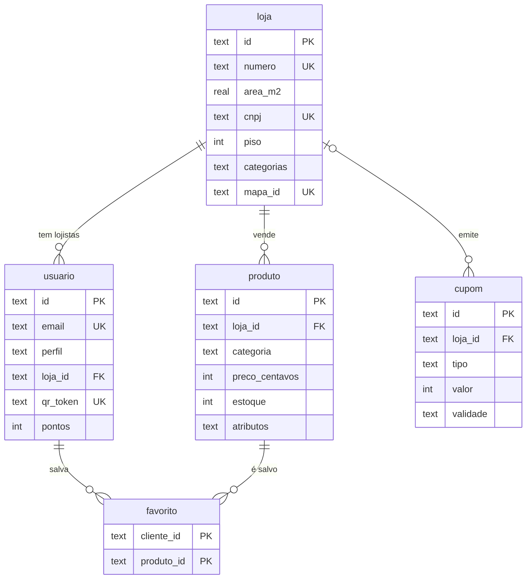
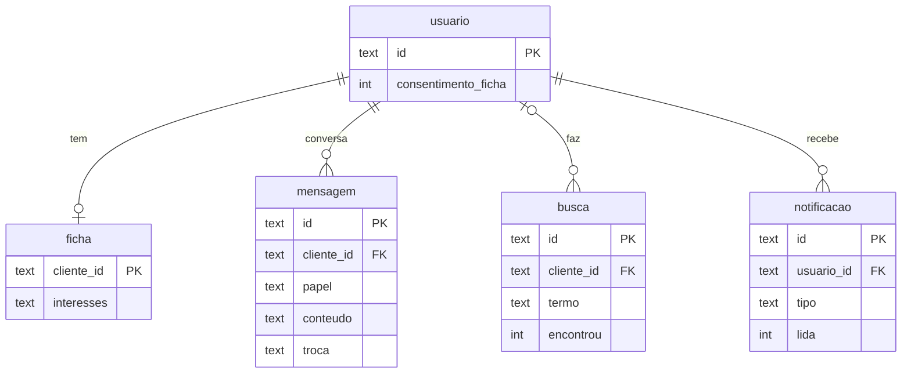
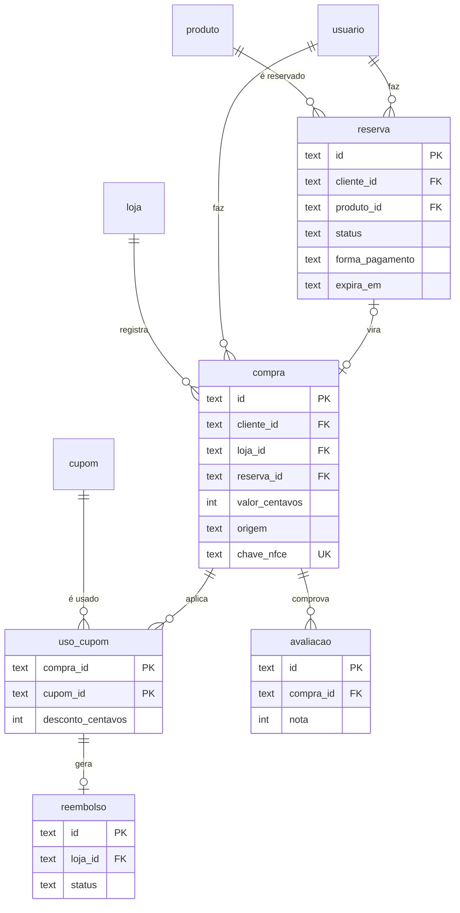

# Banco de dados

O banco é o Cloudflare D1, que usa SQLite. São 15 tabelas, criadas pela migration [`0001_inicial.sql`](../migrations/0001_inicial.sql) e ajustadas pelas seguintes, na pasta [`migrations/`](../migrations/). As regras que o banco consegue garantir sozinho (formatos, valores permitidos, unicidade, chaves estrangeiras) estão nele como `CHECK`, `UNIQUE` e `REFERENCES`; o resto fica nas regras de negócio da API.

## Convenções

| Assunto | Convenção |
| --- | --- |
| Identificadores | Texto (UUID gerado com `crypto.randomUUID()`) |
| Dinheiro | Inteiro em centavos (`preco_centavos`, `valor_centavos`), nunca número com vírgula |
| Datas | Texto ISO 8601 em UTC, gerado com `datetime('now')`; a tela converte para o horário de Palmas |
| Booleanos | Inteiro `0` ou `1` |
| Listas e objetos | JSON numa coluna de texto, validado com `json_valid` e lido com `json_extract` e `json_each` |
| Valores fixos | Texto em maiúsculas com `CHECK` (`'PENDENTE'`, `'CAIXA'`) |
| Nomes | Tabelas e colunas em português, no singular e em `snake_case` |

## Diagrama entidade-relacionamento

O diagrama está dividido em três partes para ficar legível, e mostra em cada tabela as chaves e as colunas principais. Todas as colunas estão no dicionário de dados, logo abaixo.

### Lojas, pessoas e catálogo



### Capi, ficha e notificações



### Jornada de compra



## Dicionário de dados

### loja

As unidades da planta: lojas do térreo, restaurantes da praça de alimentação e as unidades vagas (`ativa` 0), que o painel do shopping cruza com a demanda.

| Coluna | Tipo | Regra |
| --- | --- | --- |
| `id` | texto | Chave primária |
| `nome` | texto | Obrigatório; `Vaga` numa unidade vaga |
| `numero` | texto | Número da unidade na planta, sem o "LOJA" (`47`, `48A`, `PC 001C`); único. As telas mostram `LOJA 47`. Vazio só numa unidade gravada sem ele: a API usa o `mapa_id` |
| `area_m2` | real | Área da unidade em m², da planilha da planta; vazia quando ela não traz. Usada no cruzamento das vagas com a demanda |
| `cnpj` | texto | 14 dígitos, único; identifica a loja na NFC-e (RN09). Obrigatório na loja ativa e vazio na vaga |
| `piso` | inteiro | 1 (lojas) ou 2 (praça de alimentação) |
| `tipo` | texto | `loja` ou `alimentacao` |
| `categorias` | texto (JSON) | Lista das categorias que a loja vende; filtra a ficha (RN04). A primeira é a da marca (seed) e dá a capa no painel do shopping |
| `mapa_id` | texto | Id do elemento da loja no SVG da planta; único |
| `ativa` | inteiro | 0 (unidade vaga) ou 1 |

### usuario

Clientes, lojistas e administração do shopping numa tabela só.

| Coluna | Tipo | Regra |
| --- | --- | --- |
| `email` | texto | Único, sem diferenciar maiúsculas |
| `senha_hash` | texto | Hash PBKDF2 com sal; nunca a senha |
| `perfil` | texto | `CLIENTE`, `LOJISTA` ou `ADMIN_SHOPPING` |
| `loja_id` | texto | Obrigatório para lojista e proibido para os outros perfis |
| `qr_token` | texto | Só cliente; é o conteúdo do QR da carteira |
| `pontos` | inteiro | Saldo de fidelidade, nunca negativo. O nível não sai daqui: é calculado pelos pontos ganhos nas compras dos últimos 12 meses (RN08) |
| `consentimento_ficha` | inteiro | 1 quando o cliente autoriza compartilhar a ficha (RN04) |

### produto

| Coluna | Tipo | Regra |
| --- | --- | --- |
| `loja_id` | texto | Loja dona do produto |
| `categoria` | texto | Usada na busca, nos parecidos e no filtro da ficha |
| `preco_centavos` | inteiro | Maior que zero |
| `estoque` | inteiro | Nunca negativo; desconta na reserva (RN03) |
| `fotos` | texto (JSON) | Lista de URLs |
| `atributos` | texto (JSON) | Campos que mudam por categoria, como `{"numeracao":[40,41,42],"cor":"preto"}` ou `{"ml":100,"familia":"amadeirado"}` |

### reserva

| Coluna | Tipo | Regra |
| --- | --- | --- |
| `quantidade` | inteiro | De 1 a 5 |
| `preco_centavos` | inteiro | Preço no momento da reserva |
| `status` | texto | `PENDENTE`, `CONFIRMADA`, `SEPARADA`, `RETIRADA`, `CANCELADA` ou `EXPIRADA` (ver diagrama de estados na [UML](uml.md)) |
| `forma_pagamento` | texto | `NA_LOJA` ou `PIX` |
| `pago` | inteiro | Só pode ser 1 em reserva `PIX` |
| `expira_em` | texto | Criação + 4 h (`NA_LOJA`) ou + 48 h depois do pagamento (`PIX`) (RN01, RN02) |

### cupom

| Coluna | Tipo | Regra |
| --- | --- | --- |
| `loja_id` | texto | Nulo quando é voucher do shopping |
| `tipo` | texto | `PERCENTUAL` (valor de 1 a 100), `VALOR` (centavos, maior que zero) ou `BRINDE` |
| `categoria_alvo` | texto | Se preenchido, o cupom só aparece para quem tem interesse nessa categoria |
| `nivel_minimo` | texto | Nível de fidelidade exigido |
| `limite_por_cliente` | inteiro | Pelo menos 1 (RN06) |
| `validade` | texto | Data final de uso |

### compra

| Coluna | Tipo | Regra |
| --- | --- | --- |
| `reserva_id` | texto | Reserva retirada nesta compra; única, para uma reserva não virar duas compras |
| `valor_centavos` | inteiro | Valor pago, depois dos descontos; pode ser zero quando os cupons cobrem tudo (e aí gera zero pontos) |
| `origem` | texto | `CAIXA` (QR lido pelo vendedor) ou `NOTA` (NFC-e lida pelo cliente) |
| `chave_nfce` | texto | 44 dígitos, única, obrigatória quando a origem é `NOTA` (RN09) |
| `pontos_gerados` | inteiro | Pontos somados ao cliente (RN07) |
| `com_ficha` | inteiro | 1 quando o atendimento mostrou a ficha; alimenta o relatório de conversão |

### uso_cupom e reembolso

`uso_cupom` liga cada compra aos cupons usados nela, com o desconto de cada um. A chave primária (`compra_id`, `cupom_id`) impede usar o mesmo cupom duas vezes na mesma compra. `reembolso` existe para cada voucher do shopping usado numa loja (RN11); ele só pode apontar para um uso de cupom que existe, e `pago_em` é preenchido exatamente quando o status vira `PAGO`.

### mensagem, ficha e busca

`mensagem` guarda a conversa com a Capi (`papel` `CLIENTE` ou `CAPI`). Nas respostas da Capi, `troca` guarda as consultas que ela fez para responder (as chamadas de ferramenta e os resultados, em JSON, sem os blocos de raciocínio; migration 0003): elas voltam ao Claude nas mensagens seguintes, junto com o texto, para ele saber de que produtos se está falando. `ficha` guarda o resumo de interesses em JSON, como `[{"categoria":"calcados","detalhe":"tênis de corrida 42, até R$ 400"}]`; ela é apagada junto com o consentimento. `busca` registra cada busca com `encontrou` 0 ou 1, base dos relatórios de demanda (RN12).

### avaliacao, favorito e notificacao

`avaliacao` exige uma compra e é única por cliente e produto (RN10). `favorito` é a lista de produtos salvos. `notificacao` alimenta o sino do app.

### configuracao

Chave e valor em JSON, editável pelo painel do shopping. Começa com:

| Chave | Valor inicial |
| --- | --- |
| `niveis` | `{"SEMENTE":0,"BROTO":500,"CAPIM":2000,"DOURADO":5000}` |
| `prazo_reserva_horas` | `{"NA_LOJA":4,"PIX":48}` |
| `pontos_por_real` | `1` |

## Consultas importantes

**Ficha filtrada pelas categorias da loja (RN04):**

```sql
SELECT json_extract(i.value, '$.detalhe') AS interesse
FROM ficha f, json_each(f.interesses) i
JOIN usuario u ON u.id = f.cliente_id
WHERE f.cliente_id = ?1
  AND u.consentimento_ficha = 1
  AND json_extract(i.value, '$.categoria') IN (
    SELECT c.value FROM loja l, json_each(l.categorias) c WHERE l.id = ?2
  );
```

**Buscado e não encontrado na categoria da loja, últimos 30 dias:**

```sql
SELECT termo, COUNT(*) AS vezes
FROM busca
WHERE encontrou = 0
  AND categoria IN (SELECT c.value FROM loja l, json_each(l.categorias) c WHERE l.id = ?1)
  AND criado_em >= datetime('now', '-30 days')
GROUP BY termo
ORDER BY vezes DESC
LIMIT 10;
```

**Reservar descontando o estoque sem vender o que não tem (RN03):** o `UPDATE` é atômico e só desconta se houver estoque. Se ele não alterar nenhuma linha (`meta.changes = 0`), a API devolve 409; se alterar, a API cria a reserva, e se essa criação falhar, devolve o estoque. Assim dois clientes nunca reservam a última unidade ao mesmo tempo.

```sql
UPDATE produto SET estoque = estoque - ?2
WHERE id = ?1 AND ativo = 1 AND estoque >= ?2;
```

## Migrations

- Cada mudança no banco é um arquivo novo em `migrations/`, numerado em ordem (`0002_...sql`). Um arquivo já aplicado nunca é editado.
- Local: `npx wrangler d1 migrations apply tyranitar --local`.
- Produção: `npx wrangler d1 migrations apply tyranitar --remote`, **antes** de mergear o código que depende da mudança.
- As migrations só têm o esquema. Os dados da demo (lojas da planta com número e área, produtos, cupons, usuários de teste, o histórico de compras da Ana e as buscas da demonstração, para a demanda do painel do shopping) entram pelo seed: `npm run seed:local` e `npm run seed:remoto`. Ele pode rodar de novo sempre que os CSVs mudarem: atualiza lojas por `mapa_id`, usuários por e-mail e produtos e cupons por id fixo, sem duplicar. As senhas dos usuários de teste ficam só no `.dev.vars` de cada um; o banco guarda só os hashes.
