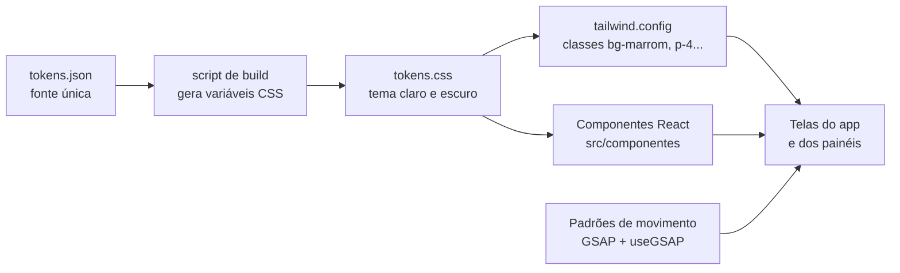

# Design system

A tecnologia sorteada para a equipe foi o **design system**. Ele é a base visual de todas as telas: o app do cliente, o painel da loja e o painel do shopping usam os mesmos tokens e os mesmos componentes. O sistema completo, com prévias ao vivo de cada componente, está publicado em [Capi · Capim Dourado](https://claude.ai/artifact/MnnouyprwtTRu9F7JV8TmL).

## Por que um design system aqui

- **Três interfaces, uma identidade.** Cliente, lojista e administração do shopping veem a mesma marca, e um botão de reservar é igual em qualquer tela.
- **Duas pessoas desenvolvendo em paralelo.** Com os componentes prontos, quem monta uma tela só encaixa peças já testadas, sem decidir cor, espaço ou tamanho de novo.
- **Acessibilidade de uma vez só.** Contraste, foco do teclado e textos para leitores de tela são resolvidos no componente e valem para todas as telas.
- **Mudança em um lugar.** Se o shopping pedir outro tom de marrom, muda um token e todas as telas acompanham.

## Identidade

A paleta parte das cores do próprio Capim Dourado Shopping:

| Papel | Token | Claro | Escuro | De onde vem |
| --- | --- | --- | --- | --- |
| Ação | `marrom` | #7F562C | #C99A66 | Barra de menu e botões do site do shopping |
| Marca e conquista | `ouro` | #B8944C | #D1B06A | O dourado do logo do shopping |
| Destaque escuro | `terra` | #3D2914 | #2C2116 | Tom de terra do cerrado, base da carteira e do avatar da Capi |
| Confirmação | `cerrado` | #2F5D3A | #86C095 | O verde das veredas do Jalapão |
| Fundo | `surface` | #FBF8F3 | #15110C | Creme do capim seco |

O padrão gráfico é a **espiral trançada** do artesanato de capim dourado: ela é o avatar da Capi, ganha uma volta a cada nível de fidelidade (Semente, Broto, Capim, Dourado) e aparece como textura na carteira.

A tipografia junta **Fraunces**, uma serifada com personalidade para títulos, e **Figtree**, uma sans legível para toda a interface. As duas vêm do Google Fonts.

## O que o sistema contém

| Parte | Conteúdo |
| --- | --- |
| Cores | 38 tokens em tema claro e escuro, cada um com a regra de uso; todos os pares de texto passam de 4,5:1 nos dois temas |
| Tipografia | 10 estilos: `display`, `title-lg`, `title-md`, `title-sm`, `body`, `body-sm`, `label`, `caption`, `price`, `metric` |
| Espaço e forma | Grade de 4px (`space-1` a `space-12`), 4 raios e 2 sombras |
| Movimento | 5 durações e 4 curvas, com o equivalente no GSAP |
| Componentes | Button, Badge, NivelBadge, ProgressoNivel, ProdutoCard, ChatBubble, ChatComposer, CupomTicket, CarteiraQR, ReservaStatus, FichaCliente, StatTile e BottomNav |
| Guia da marca | Princípios, voz e conteúdo, uso de cada cor, iconografia e acessibilidade |

## Como ele entra no código



1. **Fonte única:** `src/design-system/tokens.json` é o mesmo arquivo do design system publicado. Ninguém escreve cor, espaço ou fonte direto no código.
2. **Variáveis CSS:** um script do build transforma os tokens em `tokens.css`, com o tema claro no `:root` e o escuro em `[data-theme="dark"]`, seguindo `prefers-color-scheme`.
3. **Tailwind:** o `tailwind.config` aponta para as variáveis, por exemplo `colors: { marrom: 'var(--marrom)', 'on-marrom': 'var(--on-marrom)' }` e `spacing: { 4: 'var(--space-4)' }`. As telas escrevem `bg-marrom text-on-marrom rounded-pill`.
4. **Componentes:** os 13 componentes viram componentes React em `src/componentes/`, com os mesmos nomes e propriedades do design system. As telas importam deles, e não recriam botão ou cartão.
5. **Movimento:** as animações usam GSAP com o hook `useGSAP` do `@gsap/react`, dentro de `gsap.matchMedia()` para respeitar quem pede menos movimento. Os quatro movimentos da marca são a trança se desenhando, os cards em cascata, os pontos somando e o "subiu de nível".

```js
// tailwind.config.js (trecho)
export default {
  theme: {
    extend: {
      colors: {
        surface: 'var(--surface)', ink: 'var(--ink)', marrom: 'var(--marrom)',
        'on-marrom': 'var(--on-marrom)', ouro: 'var(--ouro)', cerrado: 'var(--cerrado)',
      },
      borderRadius: { md: 'var(--radius-md)', pill: 'var(--radius-pill)' },
      fontFamily: { display: 'var(--font-display)', sans: 'var(--font-sans)' },
      transitionTimingFunction: { saida: 'var(--ease-saida)' },
    },
  },
};
```

## Regras para a equipe

- Toda tela nova usa os componentes existentes. Precisou de um componente novo: ele entra primeiro no design system, com prévia e regra de uso, e só depois na tela.
- Nenhum valor solto no código: cor, espaço, raio, fonte e duração sempre por token.
- `marrom` só para ação, `ouro` só para marca e conquista, `cerrado` só para confirmação. Estado nunca só pela cor.
- Botão principal (`marrom`) aparece no máximo uma vez por tela.
- Mudança de token passa por pull request e atualiza o design system publicado.

## Como ele é testado

| Teste | O que garante |
| --- | --- |
| Contraste dos tokens (unidade) | Todo par de texto descrito nos tokens passa de 4,5:1 nos dois temas |
| axe-core nas telas (TX01 a TX07) | Sem violações graves de acessibilidade com os componentes montados |
| Captura de tela dos componentes (Playwright) | Um componente não muda de aparência sem querer entre um commit e outro |
| Movimento reduzido (E2E) | Com `prefers-reduced-motion`, as telas funcionam sem as animações |
