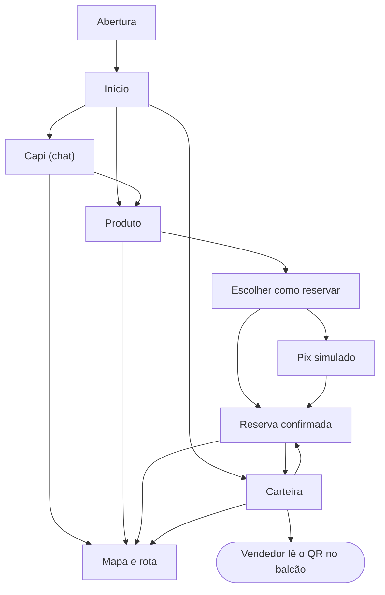

# Telas

Esta é a proposta e a estrutura inicial das telas. Elas já usam o design system e estão num protótipo navegável e animado em [Telas da Capi](https://claude.ai/artifact/YAXFDzbKidjQGk8pBoG3oy), onde dá para percorrer a jornada inteira, do chat à compra no balcão.

## Mapa de navegação do app do cliente

A Abertura aparece a cada carregamento do app (abrir o link ou recarregar a página) e depois segue para a tela que a pessoa abriu, inclusive num link direto. Um toque pula; com movimento reduzido ela é curta. A barra de navegação fixa no rodapé leva a Início, Capi, Mapa e Carteira de qualquer tela.

## App do cliente

| Tela | Para que serve | Componentes | Requisitos |
| --- | --- | --- | --- |
| Abertura | Apresentar a Capi a cada carregamento do app; a trança se desenha e um toque pula | CapiMark, Button | RF01 |
| Entrar e Criar conta | Login com e-mail e senha ou com a conta de demonstração; o cadastro pede nome, e-mail, senha e o consentimento da ficha (desmarcado por padrão) e já entra no Início, com 0 pontos, no nível Semente | Button | RF01, RF13 |
| Início | Ofertas para o cliente (no celular, a faixa de cupons desliza com o dedo; no computador, anda pelas setas, arrastando com o mouse ou pela roda), produtos salvos e atalho para a Capi | NivelBadge, CupomTicket, ProdutoCard, BottomNav | RF06, RF16 |
| Capi | Conversa com texto, foto ou link; respostas com produtos das lojas. Abre a conversa salva; vazia, mostra sugestões que só preenchem o campo (a do print do tênis anexa a foto). O botão da câmera abre uma folha com "Tirar foto" (no celular, a câmera traseira direto; no computador, a webcam com o botão de capturar) e "Escolher da galeria"; sem câmera, ou com a permissão negada, só a galeria. A foto fica anexada no campo, com prévia e um X para tirar, e só vai quando a pessoa toca em enviar (com texto junto, se quiser). "Nova conversa" apaga. Esperando, avisa "A Capi está procurando nas lojas…" depois de 2 s e desiste em 25 s com "Tentar de novo" | ChatBubble, ChatComposer, ProdutoCard | RF02, RF03, RF04 |
| Produto | Loja, piso, preço, estoque, outras lojas com o item e o botão de reservar | Badge, ProdutoCard, Button | RF05, RF07 |
| Escolher como reservar | Folha que sobe do rodapé: pagar agora com Pix ou pagar na loja | Button, Badge | RF08, RF09, RF13 |
| Pix simulado | QR do Pix e confirmação do pagamento | Button | RF09 |
| Reserva confirmada | Status da reserva e próximos passos; em aberto, "Cancelar reserva" com confirmação | ReservaStatus, Button | RF08, RF09 |
| Mapa | Mapa 3D, um piso por vez (térreo e praça de alimentação), com a loja destacada e a rota até ela. Na primeira rota, pergunta "Por qual entrada você chegou?" e lembra a resposta por 6 h; `?origem=<entrada>` (o QR de cada entrada, ids em `src/mapa/entradas.ts`) já responde. Sem resposta, a rota sai da entrada mais próxima e nenhuma vira "Você está aqui". Abre sem login, para qualquer visitante (sem a barra de navegação, com o convite "Entrar para reservar e falar com a Capi", que volta ao mesmo mapa) | Badge, Button | RF10 |
| Carteira | QR do cliente, pontos, progresso de nível, Minhas reservas (status, prazo, "Como chegar" e "Cancelar reserva") e cupons | CarteiraQR, ProgressoNivel, Badge, Button, CupomTicket | RF08, RF10, RF11, RF12 |
| Minha conta | Nome (editável), e-mail, nível e pontos; trocar a senha pedindo a atual; a ficha que a Capi anotou, com o consentimento e um botão de apagar em cada interesse; baixar os dados em JSON (LGPD); sair e excluir a conta | NivelBadge, Button | RF01, RF13 |

## Painéis no celular e no tablet

Os dois painéis funcionam de 390 px em diante sem rolar para o lado. Abaixo de 1024 px, a barra lateral vira uma barra no topo com o botão Menu, que abre a lista de telas (Esc ou a escolha de uma tela fecham); as tabelas viram cartões, um por linha, e os formulários ficam em uma coluna no celular.

## Painel da loja

| Tela | Para que serve | Componentes | Requisitos |
| --- | --- | --- | --- |
| Atendimento | Ler o QR do cliente, ver a ficha e as reservas, registrar a compra com os cupons | FichaCliente, ReservaStatus, StatTile, Button | RF18, RF19 |
| Reservas | Lista das reservas do dia por status, com confirmar, separar e retirar | ReservaStatus, Badge | RF20 |
| Produtos | Catálogo da loja, cadastro com atributos por categoria e importação de planilha | ProdutoCard, Button | RF21, RF22 |
| Cupons | Criar cupons da loja e acompanhar o uso | CupomTicket, Button | RF23 |
| Desempenho | Mais vendidos, mais buscados, buscados e não encontrados, picos | StatTile | RF24, RF25 |

## Painel do shopping

| Tela | Para que serve | Componentes | Requisitos |
| --- | --- | --- | --- |
| Lojas | Cadastro de lojas e lojistas | Button, Badge | RF27 |
| Fidelidade e campanhas | Níveis, vouchers e campanhas da vitrine | NivelBadge, CupomTicket | RF28 |
| Demanda | O que os clientes procuram e não acham em nenhuma loja | StatTile | RF29 |
| Jornada e reembolsos | Conversão das reservas e reembolsos devidos às lojas | StatTile | RF30, RF31 |
| QR das entradas | Um QR por entrada, com o link do mapa já saindo dela (`/mapa?origem=<entrada>`), a letra e o piso; "Imprimir" sai um por página, sem a barra lateral | Button | RF10 |

## Estados de cada tela

Toda tela prevê quatro estados, todos com os componentes do design system:

- **Carregando:** esqueleto no formato do conteúdo, sem tela branca.
- **Vazio:** frase curta dizendo o que fazer ("Você ainda não salvou nenhum produto. Pergunte à Capi.").
- **Erro:** o que aconteceu e como resolver, com botão de tentar de novo. Se a Capi cair, a busca comum continua (RNF10).
- **Com dados:** o estado mostrado no protótipo.

## Prévia

Telas reais do app do cliente, num Chrome emulando celular (390 × 844), com os dados do seed e a Capi respondendo à pergunta do roteiro da demonstração (a sugestão com o print do tênis):

Atendimento no painel da loja, depois de ler o QR da Ana (painel da branch fase-4, com os dados de exemplo dela):

O mapa é 3D (React Three Fiber), um piso por vez, porque o térreo e o 2º piso têm escalas diferentes. As plantas ficam em `src/mapa/piso-1.svg` e `piso-2.svg`, cada loja com o id do seu número (`loja-209`), e a rota sai de `src/mapa/rotas.json` (pontos e caminhos, em metros) pelo menor caminho.
