# Telas

Esta é a proposta e a estrutura inicial das telas. Elas já usam o design system e estão num protótipo navegável e animado em [Telas da Capi](https://claude.ai/artifact/YAXFDzbKidjQGk8pBoG3oy), onde dá para percorrer a jornada inteira, do chat à compra no balcão.

## Mapa de navegação do app do cliente

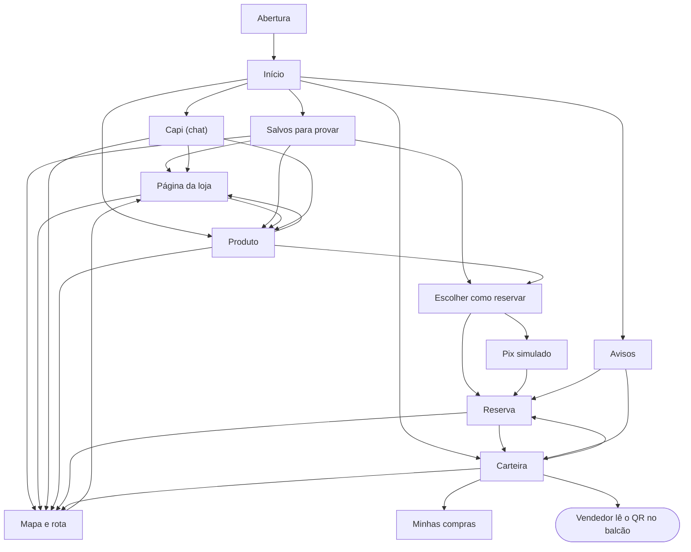

A Abertura aparece a cada carregamento do app (abrir o link ou recarregar a página) e depois segue para a tela que a pessoa abriu, inclusive num link direto. Um toque pula; com movimento reduzido ela é curta. A barra de navegação fixa no rodapé leva a Início, Salvos, Capi, Mapa e Carteira de qualquer tela.

## App do cliente

| Tela | Para que serve | Componentes | Requisitos |
| --- | --- | --- | --- |
| Abertura | Apresentar a Capi a cada carregamento do app; a trança se desenha e um toque pula | CapiMark, Button | RF01 |
| Entrar e Criar conta | Login com e-mail e senha ou com a conta de demonstração; o cadastro pede nome, e-mail, senha e o consentimento da ficha (desmarcado por padrão) e já entra no Início, com 0 pontos, no nível Semente | Button | RF01, RF13 |
| Início | O sino dos avisos no topo, com o selo de quantos são novos: cada mudança da reserva (enviada, confirmada com a hora, separada, recusada com o motivo, expirada, retirada) e os pontos de uma compra. Tocar abre a lista, marca todos como lidos e cada aviso leva à tela dele. Ofertas para o cliente (no celular, a faixa de cupons desliza com o dedo; no computador, anda pelas setas, arrastando com o mouse ou pela roda), Salvos para provar (os três mais recentes, com o coração, e "Ver todos"; vazio, o link para os salvos explicando o coração) e atalho para a Capi | NivelBadge, CupomTicket, ProdutoCard, BottomNav | RF06, RF16 |
| Capi | Conversa com texto, foto ou link; respostas com produtos das lojas. Abre a conversa salva; vazia, mostra sugestões que só preenchem o campo (a do print do tênis anexa a foto). O botão da câmera abre uma folha com "Tirar foto" (no celular, a câmera traseira direto; no computador, a webcam com o botão de capturar) e "Escolher da galeria"; sem câmera, ou com a permissão negada, só a galeria. A foto fica anexada no campo, com prévia e um X para tirar, e só vai quando a pessoa toca em enviar (com texto junto, se quiser). "Nova conversa" apaga. Os cartões de produto têm o coração de salvar, e o nome da loja abre a página dela. Esperando, avisa "A Capi está procurando nas lojas…" depois de 2 s e desiste em 25 s com "Tentar de novo". Quando o catálogo não tem o item, indica as lojas da categoria e oferece o caminho no mapa, sem inventar produto, preço ou estoque | ChatBubble, ChatComposer, ProdutoCard | RF02, RF03, RF04 |
| Produto | Loja, piso, preço, estoque, outras lojas com o item e o botão de reservar. O coração ao lado do nome salva o produto; o nome da loja abre a página dela | Badge, ProdutoCard, Button | RF05, RF07, RF16 |
| Escolher como reservar | Folha que sobe do rodapé: o tamanho (ou a numeração) e a cor, das opções do produto; o cupom, só entre os que valem para ele ("Sem cupom" ou, por exemplo, "10% em calçados", "Calçados na Loja de esportes", com o desconto); o total já com o desconto; e pagar agora com Pix ou pagar na loja. Avisa que a loja confirma e diz a partir de que horas fica pronto | Button, Badge | RF08, RF09, RF13, RN15 |
| Pix simulado | QR do Pix, no valor já com o desconto do cupom, e confirmação do pagamento | Button | RF09 |
| Reserva | O andamento com a loja: "Reserva enviada" (esperando a loja), "Reserva confirmada" (pronta para retirar a partir das HH:MM), "Separado para você", "Reserva retirada" e "Reserva recusada", com o motivo que a loja escreveu. Mostra o tamanho, a cor, o valor e o cupom, e os passos (feita, confirmada pela loja com a hora, separada, retirada). Em aberto, "Cancelar reserva" com confirmação; o cupom volta para a carteira | ReservaStatus, Button | RF08, RF09, RF14, RF20 |
| Salvos para provar | Os produtos salvos com o coração (`/salvos`, aba Salvos), agrupados por loja, a do salvo mais recente primeiro. Cada produto tem "Reservar" (a folha de reservar) e cada loja, "Como chegar" e o nome que abre a página dela. Tirar o coração ali deixa o produto na lista até a próxima visita, para dar para voltar atrás | ProdutoCard, Button | RF08, RF10, RF16 |
| Página da loja | `/lojas/{id}` (no plural: `/loja` é o painel do lojista). Nome, categoria principal, piso, os produtos da loja em grade (com o coração) e "Como chegar". Abre pelo nome da loja no produto, nos cartões da Capi e do Início, nos salvos e no mapa | Badge, ProdutoCard, Button | RF07, RF10 |
| Mapa | Mapa 3D, um piso por vez (térreo e praça de alimentação), com a loja destacada e a rota até ela. Na primeira rota, pergunta "Por qual entrada você chegou?" e lembra a resposta por 6 h; `?origem=<entrada>` (o QR de cada entrada, ids em `src/mapa/entradas.ts`) já responde. Sem resposta, a rota sai da entrada mais próxima e nenhuma vira "Você está aqui". "Trocar a entrada" é um botão ao lado de "Saindo da Entrada A", e tocar numa entrada no próprio mapa (o marco ou a etiqueta) escolhe ela e refaz a rota na hora. Abre sem login, para qualquer visitante (sem a barra de navegação, com o convite "Entrar para reservar e falar com a Capi", que volta ao mesmo mapa). Para quem entrou, o nome da loja de destino abre a página dela | Badge, Button | RF10 |
| Carteira | QR do cliente, pontos, progresso de nível, Minhas reservas ("Esperando a loja" ou "Confirmada · pronta às HH:MM", o tamanho, a cor, o valor e o cupom, o prazo, "Como chegar" e "Cancelar reserva"; o ícone da Carteira na barra tem o selo das mudanças de reserva ainda não vistas, que some ao abrir), Minhas compras (as três últimas, com loja, dia, valor pago, cupons usados e pontos ganhos, e "Ver tudo") e cupons, cada um dizendo para que vale ("Calçados na Centauro"; o cupom preso numa reserva em aberto sai da lista até ela sair) | CarteiraQR, ProgressoNivel, Badge, Button, CupomTicket | RF08, RF10, RF11, RF12, RF16 |
| Minhas compras | A lista inteira das compras (`/carteira/compras`), da mais nova para a mais antiga, dez por vez: "Mostrar mais" traz as próximas, diz quantas aparecem e põe o foco na primeira que chegou | Badge, Button | RF11, RF16 |
| Minha conta | Nome (editável), e-mail, nível e pontos; trocar a senha pedindo a atual; a ficha que a Capi anotou, com o consentimento e um botão de apagar em cada interesse; baixar os dados em JSON (LGPD); a aparência (Automático, que segue o aparelho, Claro ou Escuro), salva no aparelho e aplicada antes da primeira pintura; sair e excluir a conta | NivelBadge, Button | RF01, RF13 |

O easter egg "O tirano da sexta-feira 13" acrescenta, só no modo tirano, o mapa no escuro, a Loja 13, o nível Tirano na carteira e o Piso 13 no seletor de piso. Os gatilhos e as telas estão em [easter-egg.md](easter-egg.md).

## Painéis no celular e no tablet

Os dois painéis funcionam de 390 px em diante sem rolar para o lado. O rodapé da barra lateral tem o mesmo seletor de aparência da Minha conta (a escolha é do aparelho e vale nas três interfaces). Abaixo de 1024 px, a barra lateral vira uma barra no topo com o botão Menu, que abre a lista de telas (Esc ou a escolha de uma tela fecham) e mostra o total dos selos, como o das reservas novas; as tabelas viram cartões, um por linha, e os formulários ficam em uma coluna no celular.

## Painel da loja

| Tela | Para que serve | Componentes | Requisitos |
| --- | --- | --- | --- |
| Atendimento | Ler o QR do cliente (câmera ou "Simular leitura") e ver o nome, o nível e a ficha; as reservas dela nesta loja, com o tamanho, o valor, o cupom e "Já pago com Pix" ou "Pagar no caixa": "Retirar" põe a confirmada na compra, e a pendente pede "Confirmar agora". A compra junta os itens: a reserva, produtos da busca no catálogo da loja (com a quantidade) e "Outros", um valor sem produto. Os cupons vêm em dois grupos, o da loja e o voucher do shopping, só os que descontam em algum item da compra (os outros aparecem com o motivo, como "só em calçados"). Cada item mostra o desconto de cada cupom, e o total, "Cliente paga" e os pontos, pela prévia da API; "Registrar compra" (ou "Registrar retirada", quando tudo já foi pago por Pix) abre o recibo com os itens | FichaCliente, Badge, Button | RF18, RF19, RN05, RN15 |
| Reservas | As reservas da loja em filtros (Ativas, Novas, Confirmadas, Separadas e Encerradas), as novas primeiro. Cada cartão mostra o produto, a cliente, o tamanho, a cor, o valor (com o "era" quando teve cupom), o cupom e de quem é, o pagamento e o prazo: "Responder até" na nova, "Pronta a partir de" e "Retirar até" na confirmada. "Confirmar" abre o campo da hora em que fica pronta, já com a próxima meia hora, e diz "Hoje" ou "Amanhã, a partir das 09:00"; "Recusar" explica o que acontece e pede o motivo, que a cliente vê; "Separar" aparece na confirmada. A recusada mostra o motivo. A tela pergunta à API a cada 20 s: o item Reservas do menu ganha o selo com quantas esperam a loja, a reserva nova toca um som curto (que se desliga no topo da tela, e a escolha fica no aparelho) e o leitor de tela ouve "Reserva nova: Camiseta dry-fit para Ana." Com a aba escondida, não pergunta | Badge, Button | RF20, RN01, RN03 |
| Produtos | Catálogo da loja, cadastro com atributos por categoria e importação de planilha | ProdutoCard, Button | RF21, RF22 |
| Cupons | Criar cupons da loja e acompanhar o uso | CupomTicket, Button | RF23 |
| Desempenho | Mais vendidos (pelos itens das compras), mais buscados, buscados e não encontrados, picos e o que aconteceu com as reservas, com as recusadas pela loja à parte | StatTile | RF24 |
| Extrato | As compras do caixa no período, cada uma com a cliente e os itens (o desconto de cada um e os que vieram de reserva), os descontos da loja e do shopping e os reembolsos a receber | StatTile | RF25 |

## Painel do shopping

| Tela | Para que serve | Componentes | Requisitos |
| --- | --- | --- | --- |
| Lojas | Cadastro de lojas e lojistas | Button, Badge | RF27 |
| Fidelidade e campanhas | Níveis, vouchers e campanhas da vitrine | NivelBadge, CupomTicket | RF28 |
| Demanda | O que os clientes procuram e não acham em nenhuma loja | StatTile | RF29 |
| Jornada e reembolsos | Conversão das reservas e reembolsos devidos às lojas | StatTile | RF30, RF31 |
| QR das entradas | Um QR por entrada, com o link do mapa já saindo dela (`/mapa?origem=<entrada>`), a letra e o piso; "Imprimir" sai um por página, sem a barra lateral | Button | RF10 |

## Estados de cada tela

Toda tela prevê quatro estados, todos com os componentes do design system:

- **Carregando:** esqueleto no formato do conteúdo, sem tela branca.
- **Vazio:** frase curta dizendo o que fazer ("Nenhuma compra ainda. Mostre o QR da carteira no caixa para juntar pontos.").
- **Erro:** o que aconteceu e como resolver, com botão de tentar de novo. Se a Capi cair, a busca comum continua (RNF10).
- **Com dados:** o estado mostrado no protótipo.

## Prévia

Telas reais do app do cliente, num Chrome emulando celular (390 × 844), com os dados do seed e a Capi respondendo à pergunta do roteiro da demonstração (a sugestão com o print do tênis):

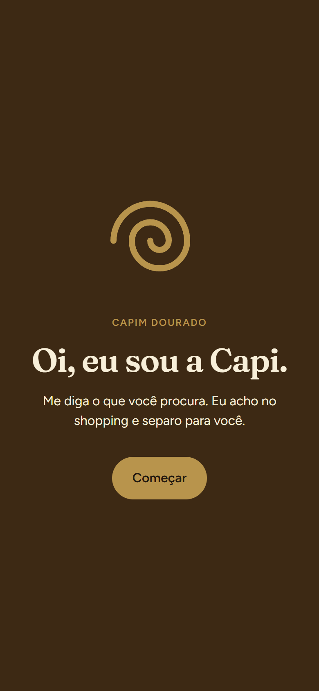
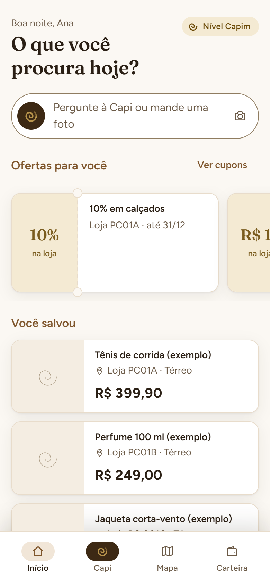
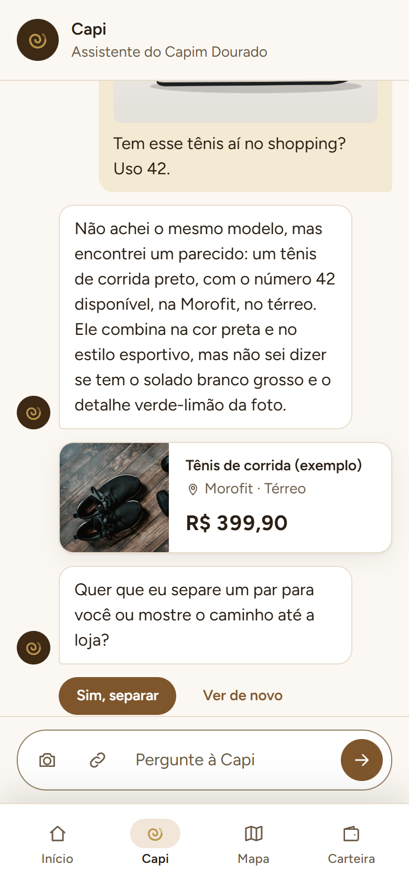
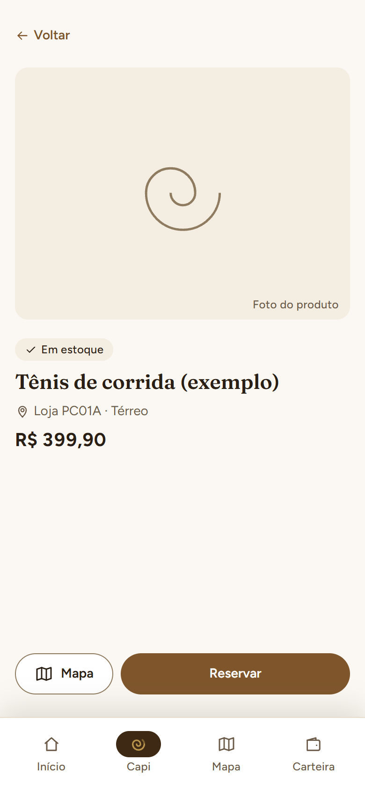
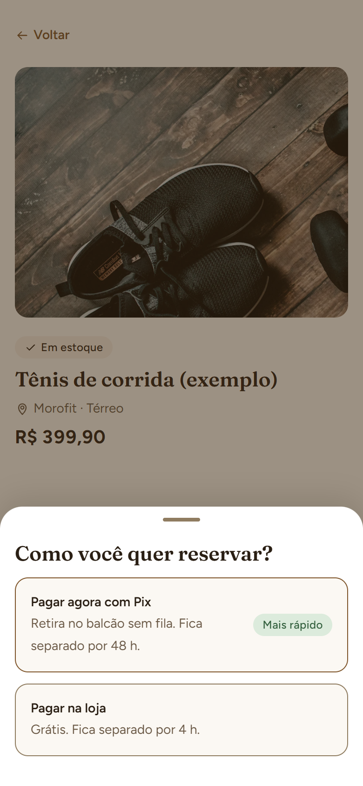
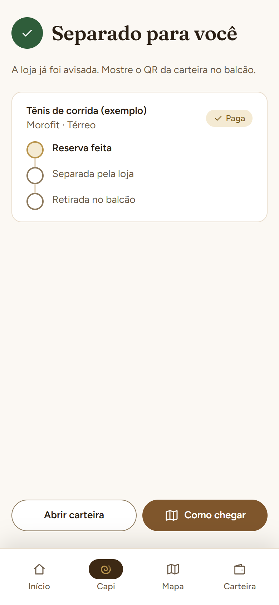
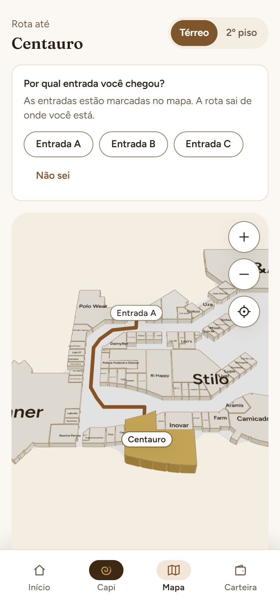
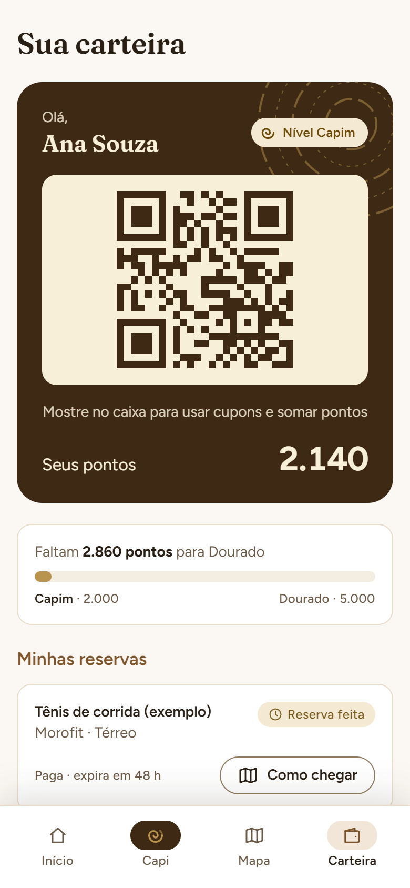
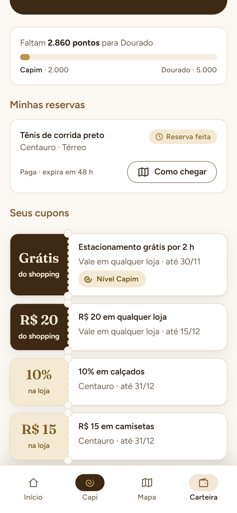

Atendimento no painel da loja, depois de ler o QR da Ana (painel da branch fase-4, com os dados de exemplo dela):

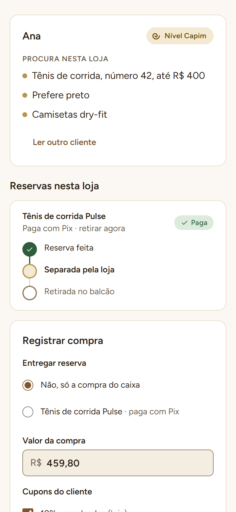

O mapa é 3D (React Three Fiber), um piso por vez, porque o térreo e o 2º piso têm escalas diferentes. As plantas ficam em `src/mapa/piso-1.svg` e `piso-2.svg`, cada loja com o id do seu número (`loja-209`), e a rota sai de `src/mapa/rotas.json` (pontos e caminhos, em metros) pelo menor caminho.
