# UML

Diagramas do sistema em Mermaid. Eles aparecem desenhados no GitHub e nos PDFs da documentação. Os códigos RF e RN são os de [requisitos.md](requisitos.md).

## Casos de uso

Os casos de uso estão divididos por perfil para caberem na leitura. A Capi usa o Claude (IA da Anthropic) como sistema externo.

### Cliente: descobrir e reservar

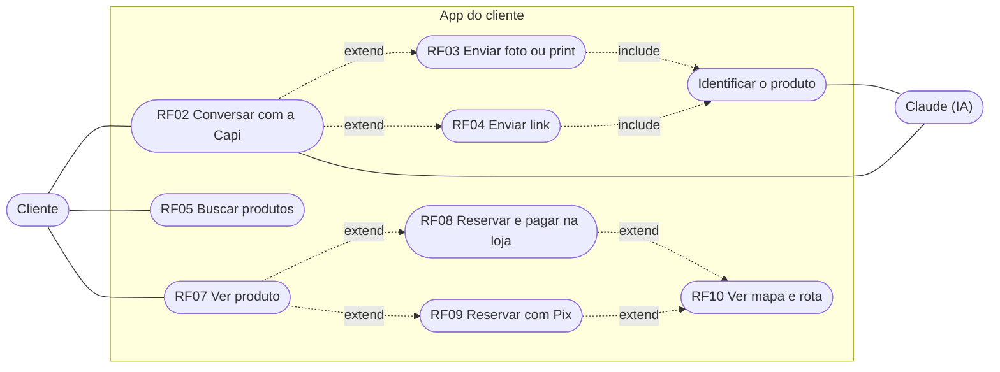

### Cliente: conta, carteira e ofertas

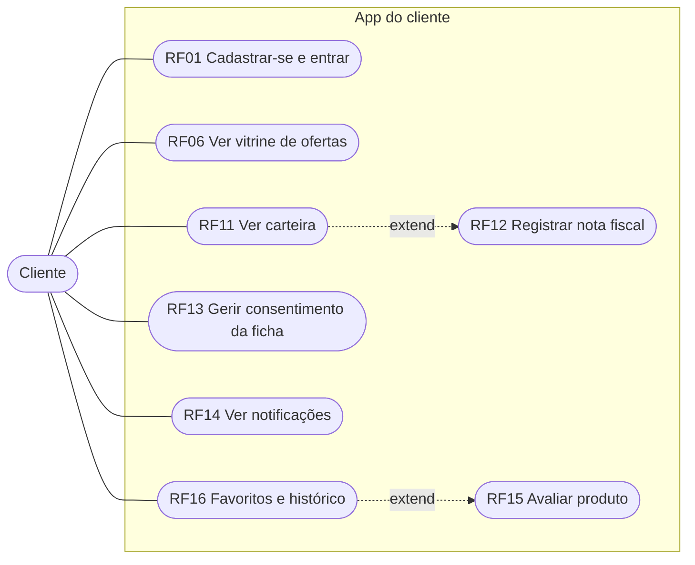

### Lojista

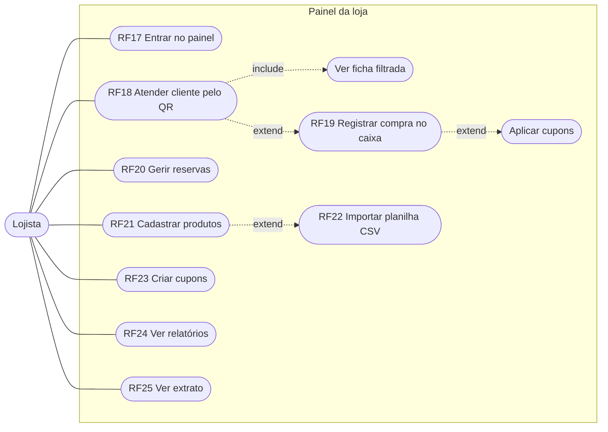

### Administração do shopping

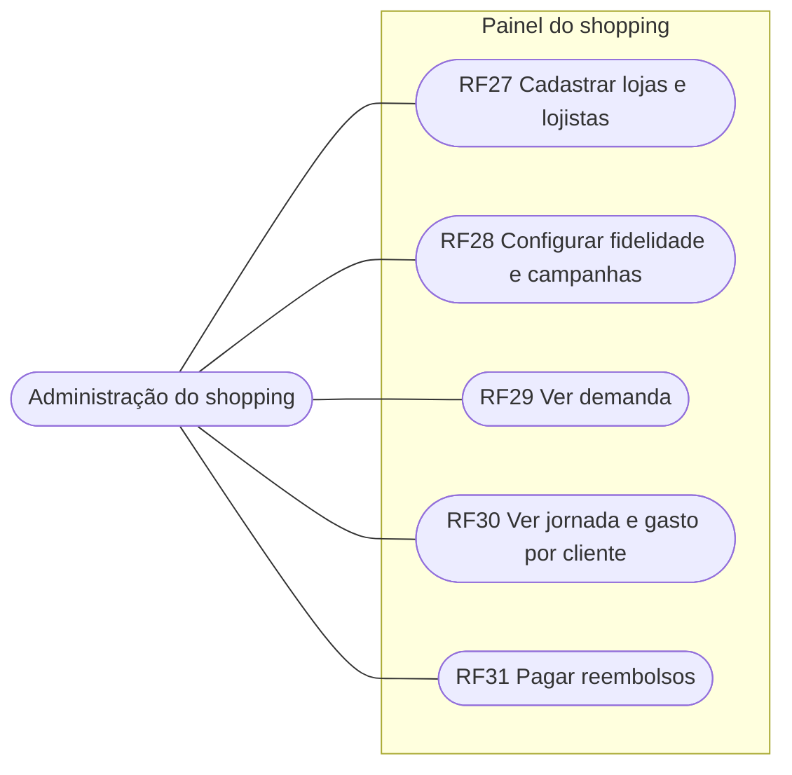

## Diagrama de classes

O modelo de domínio está em três diagramas: pessoas e lojas; reserva, compra e cupons; e conversa, buscas e avaliações. Valores em dinheiro são inteiros em centavos.

### Pessoas, lojas e catálogo

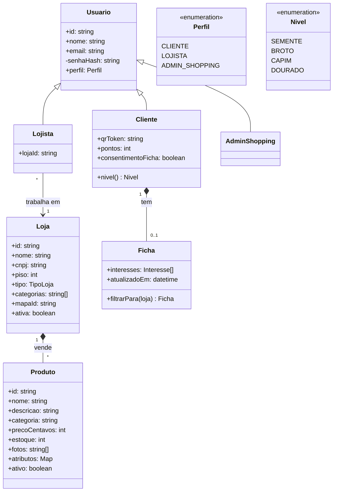

### Reserva, compra e cupons

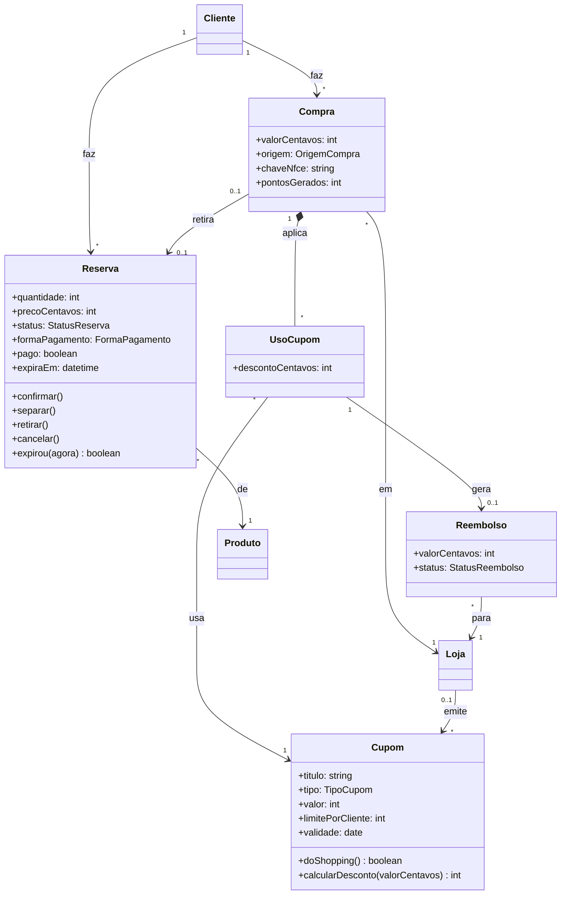

### Conversa, buscas e avaliações

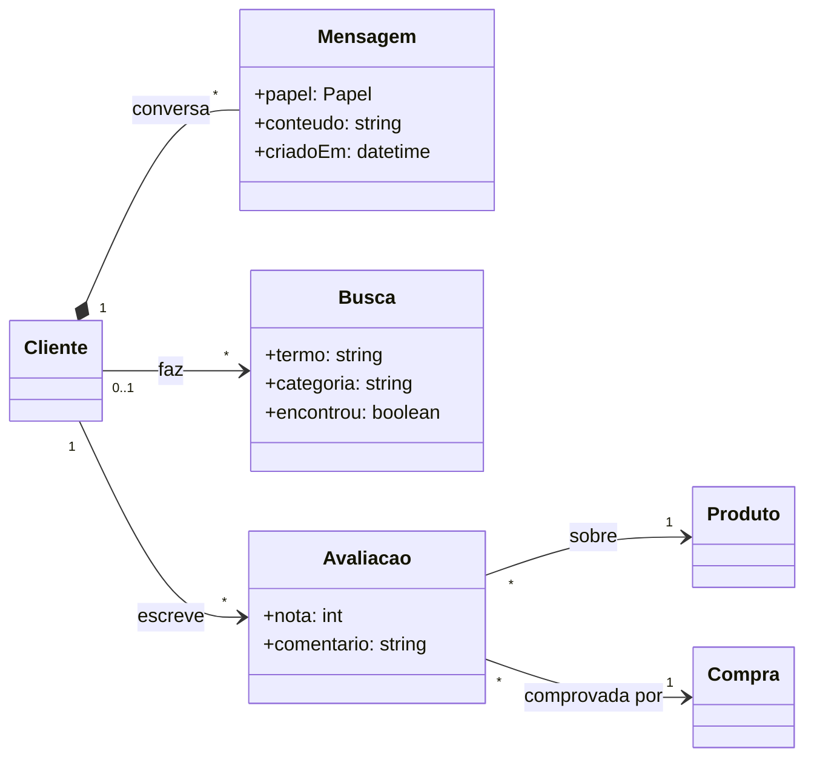

Os estados da reserva estão no diagrama de estados, no fim deste documento.

Um cupom sem loja (`lojaId` nulo) é um voucher do shopping (RN11).

## Diagramas de sequência

### Busca por foto (RF03)

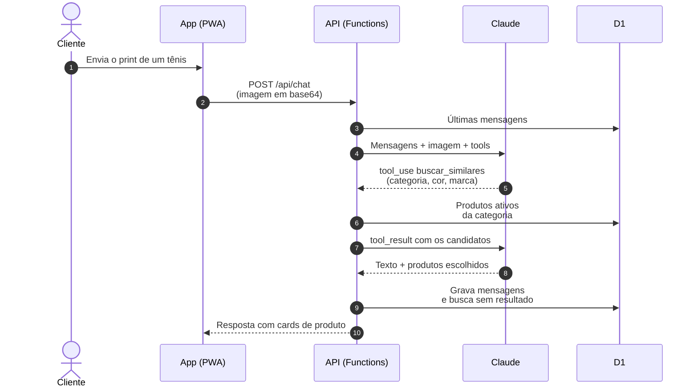

### Reserva com Pix e rota (RF09, RF10)

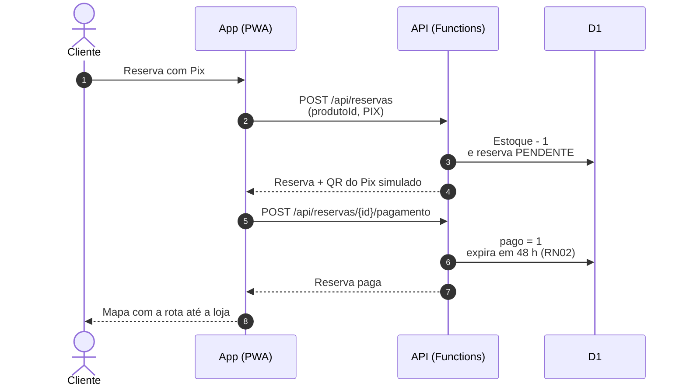

### Atendimento com QR e compra no caixa (RF18, RF19)

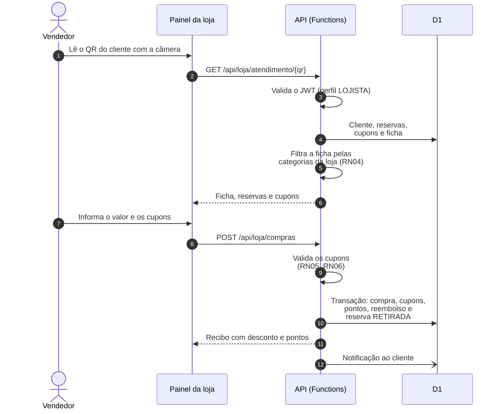

### Registro por nota fiscal (RF12)

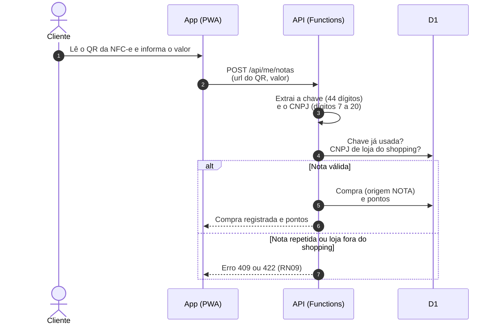

Na versão atual do QR da NFC-e, o valor da compra não vem no código. O cliente informa o valor e ele aparece no extrato da loja. Em produção, o valor pode ser confirmado pela consulta pública da Sefaz.

## Diagrama de estados da reserva

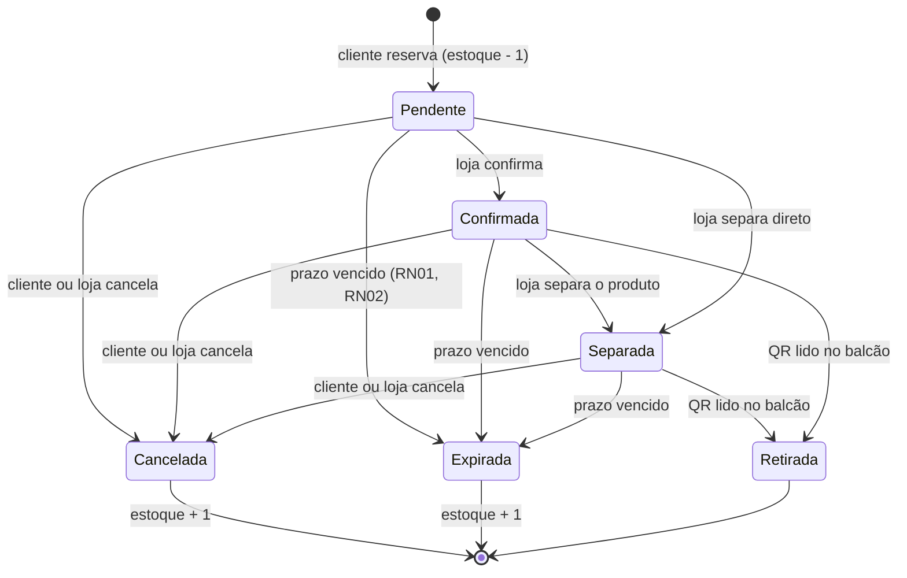

A expiração é conferida sempre que uma reserva é lida, porque Pages Functions não roda tarefas agendadas.
